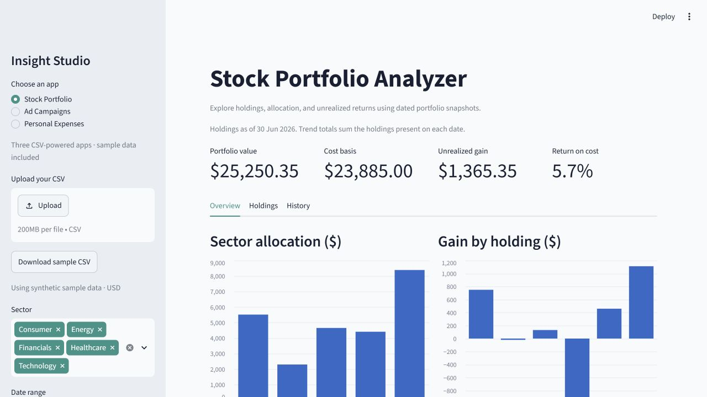

# Insight Studio — three Streamlit apps

Includes Path A (Stock Portfolio), Path B (Ad Campaigns), and Path C (Personal Expenses). Choose an app in the sidebar. Each includes synthetic sample data, CSV upload, shared filters, charts, and CSV exports. No accounts or API keys required.

## Run

Install Python 3.11 or later. Open a terminal in this folder:

```powershell
python -m venv .venv
.\.venv\Scripts\python -m pip install -r requirements.txt
.\.venv\Scripts\python -m streamlit run app.py
```

Open http://localhost:8501. Stop the server with Ctrl+C.

## CSV formats

Use the included files in `data/` as templates. Dates use YYYY-MM-DD. Monetary values are USD, without currency symbols or thousands separators. Required fields cannot be blank; numeric values must be nonnegative.

- Stocks: `date,symbol,sector,shares,cost_basis,price`. One row per symbol per snapshot date; cost_basis is the average purchase price per share. Supply complete snapshots for comparable trends. Holdings use only the latest selected snapshot.
- Campaigns: `date,campaign,platform,spend,impressions,clicks,conversions,revenue`. Revenue is attributed campaign revenue. Counts satisfy conversions <= clicks <= impressions.
- Expenses: `date,category,merchant,amount,payment_method`. One row per expense; refunds are not supported.

Portfolio return is unrealized return on cost, not a time-weighted performance measure. Campaign ROI excludes costs other than advertising. Expense budgets compare selected spending to a full monthly budget. All included datasets are fictional and use fixed dates from January through June 2026.

Navigation and widgets use the official [Streamlit documentation](https://docs.streamlit.io/develop/api-reference).

## Validate and regenerate samples

```powershell
.\.venv\Scripts\python scripts/test_apps.py
.\.venv\Scripts\python scripts/generate_data.py
```

The sample generator uses a fixed random seed. Tests exercise all three apps, validate portfolio and campaign calculations, and check filters and zero budgets.


