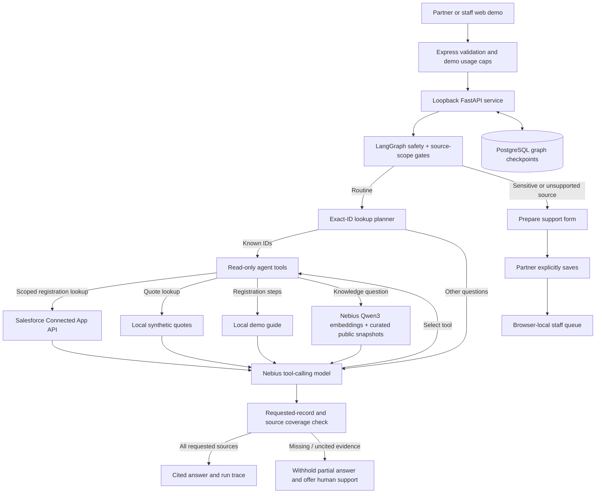

# Partner Operations Copilot

A Week 3 bring-your-own-use-case project using **Python LangChain + LangGraph**, Nebius Token Factory, PostgreSQL checkpoints, and a React partner/staff demo workspace.

## What works

- Four agent tools: partner-scoped deal status, demo quote status, registration-guide search, and semantic search over cited public partner knowledge.
- Read-only Salesforce Connected App access for demo Deal_Registration__c records; the AI interprets questions and summarizes the records returned by the API.
- Public knowledge retrieval with Nebius Qwen3 embeddings and source-grounded answers from a curated local snapshot.
- Multi-step agent/tool control flow, conversation memory, citations, and visible execution traces.
- Sensitive-question safety routing and explicit human submission/review of browser-local support requests.
- Timeouts, bounded tool rounds, not-found handling, and labeled deterministic fallbacks.

Red Valley and Bluewater demo registrations are read from Salesforce. Other partner records and all quote examples are synthetic; native Salesforce Quotes are not connected. The public knowledge library contains curated snapshots from CISA, NIST, Channeltivity, Training Industry, and PartnerStack. These references are not company policy, an internal asset library, or live release information. The role switch is **not authentication**, and support requests are not shared across browsers.

## Setup

Prerequisites: Node.js 24, pnpm, Python 3.13, uv, and PostgreSQL.

1. Set `DATABASE_URL` and `NEBIUS_API_KEY` using the environment's secret manager. Never commit them.
2. Run `pnpm install --frozen-lockfile` and `uv sync --frozen`.
3. On the development database, run `uv run python -m partner_agent_graph.setup_checkpoint` once to create the checkpoint schema.
4. Run `bash scripts/run-api-stack.sh development` from the repository root.
5. Start the web artifact using its managed workflow. Outside Replit, set `PORT` and `BASE_PATH=/` and run `pnpm --filter @workspace/partner-status-agent run dev`; configure a `/api` reverse proxy to port 8080.

In Replit, the existing API artifact workflow starts FastAPI on loopback port 8000 and Express on port 8080. The web artifact is at `/` and API routes are at `/api`.

Salesforce-backed demo partners additionally require the Replit-managed Salesforce connection to the approved Developer Edition org. The integration is intentionally pinned to fixed sample records, not any arbitrary Salesforce org. Outside that configured environment, select a local synthetic partner; do not substitute local results for a failed Salesforce lookup. See [Salesforce setup and access boundaries](salesforce/README.md).

## Checks

```sh
uv run pytest -q
pnpm run typecheck
PORT=5000 BASE_PATH=/ pnpm run build
```

API example (use a fresh partner-prefixed thread ID for a new conversation):

```sh
curl http://127.0.0.1:8080/api/partner-agent/answer \
  -H 'Content-Type: application/json' \
  -d '{"question":"Status of DR-2841?","partnerId":"p-northstar","threadId":"p-northstar-example-thread"}'
```

## Architecture



## Important limits

- This is a working public portfolio demo, not a production partner portal.
- Salesforce access is read-only and limited to demo records; the Connected App/API integration itself is conventional authentication and data retrieval, not AI.
- Knowledge documents are curated snapshots; retrieval is not live web search. The answer model must cite retrieved material and cannot treat it as company policy.
- Local synthetic data lives in JSON files shared by the UI and tools; native Salesforce Quotes are not enabled.
- Checkpoint messages persist in PostgreSQL; no automatic retention policy is implemented. Do not enter confidential information.
- Usage limits are in memory (10 requests/IP/hour and 100/day) and reset on restart; they are not a billing guarantee.
- Before a real pilot, add authentication and server-side tenant authorization, replace public demo references with approved company knowledge/assets, connect native Salesforce Quotes if needed, and add a shared audited helpdesk queue and retention controls.
- Production startup does not create tables. Review the development-to-production schema migration when publishing; do not run the development setup script blindly against production.

## Submission assets

- [Project documentation](artifacts/partner-status-agent/docs/week-3-submission-notes.md)
- [Under-five-minute demo script](artifacts/partner-status-agent/docs/demo-script.md)
- `uv run python scripts/export-submission-doc.py` creates an importable Google Docs document in `generated-artifacts/`.

Upload the code to GitHub without secrets, record the live demo, import the documentation into Google Docs, and submit the three links in the Week 3 form.

## Architecture and visual walkthrough

- [Current implementation, workflow, security boundaries, and annotated screenshots](docs/partner-copilot-explainer/README.md)
- The folder contains portable SVG diagrams and current screenshots of demo-only Salesforce registrations and local synthetic examples.
- Generated HTML/DOCX, PDFs, Library downloads, and previously downloaded ZIPs are snapshots, not automatically refreshed copies. Regenerate them from current sources before using them in a submission.

Regenerate the GitHub-ready SVGs and self-contained HTML with `uv run python scripts/export-architecture-report.py`. The PDF includes screenshots of the current demo UI; recapture those screens and regenerate the PDF after a material visual or feature change. These generated exports are convenience downloads; include `docs/partner-copilot-explainer/` in the application repository.

### Historical video — not the final demo

The earlier [`partner-copilot-walkthrough`](artifacts/partner-copilot-walkthrough/README.md) film and its media/source files are retained as a historical snapshot. They predate Salesforce connectivity and public-knowledge retrieval and are **not** the current architecture or final submission recording. Use the current explainer, submission notes, and live demo script linked above.
