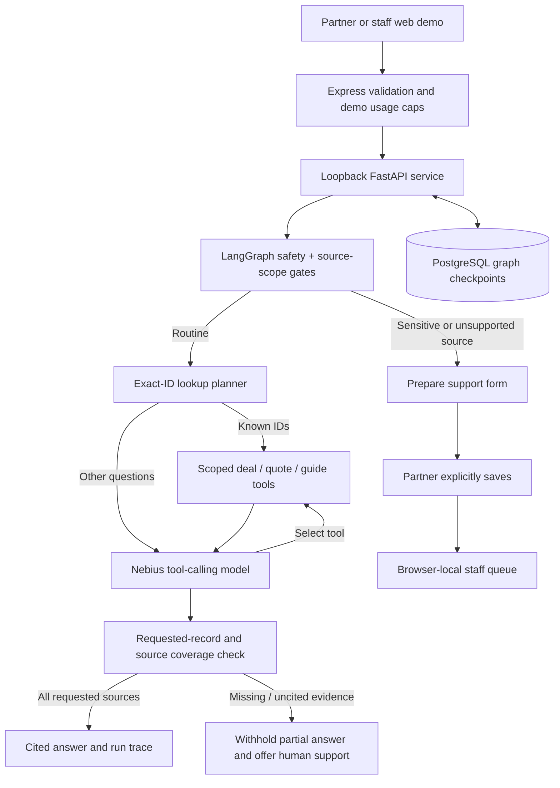

# Partner Operations Copilot

A Week 3 bring-your-own-use-case project using **Python LangChain + LangGraph**, Nebius Token Factory, PostgreSQL checkpoints, and a React partner/staff demo workspace.

## What works

- Agent-selected, partner-scoped deal, quote, and registration-guide tools.
- Multi-step agent/tool control flow, conversation memory, citations, and visible execution traces.
- Sensitive-question safety routing and explicit human submission/review of browser-local support requests.
- Timeouts, bounded tool rounds, not-found handling, and labeled deterministic fallbacks.

All records are synthetic. Salesforce is **not connected**. The role switch is **not authentication**, and support requests are not shared across browsers.

## Setup

Prerequisites: Node.js 24, pnpm, Python 3.13, uv, and PostgreSQL.

1. Set `DATABASE_URL` and `NEBIUS_API_KEY` using the environment's secret manager. Never commit them.
2. Run `pnpm install --frozen-lockfile` and `uv sync --frozen`.
3. On the development database, run `uv run python -m partner_agent_graph.setup_checkpoint` once to create the checkpoint schema.
4. Run `bash scripts/run-api-stack.sh development` from the repository root.
5. Start the web artifact using its managed workflow. Outside Replit, set `PORT` and `BASE_PATH=/` and run `pnpm --filter @workspace/partner-status-agent run dev`; configure a `/api` reverse proxy to port 8080.

In Replit, the existing API artifact workflow starts FastAPI on loopback port 8000 and Express on port 8080. The web artifact is at `/` and API routes are at `/api`.

## Checks

```sh
uv run pytest -q
pnpm run typecheck
PORT=5000 BASE_PATH=/ pnpm run build
```

API example (use a fresh partner-prefixed thread ID for a new conversation):

```sh
curl http://127.0.0.1:8080/api/partner-agent/answer \
  -H 'Content-Type: application/json' \
  -d '{"question":"Status of DR-2841?","partnerId":"p-northstar","threadId":"p-northstar-example-thread"}'
```

## Architecture



## Important limits

- This is a working public portfolio demo, not a production partner portal.
- Synthetic data lives in one JSON file shared by the UI and tools.
- Checkpoint messages persist in PostgreSQL; no automatic retention policy is implemented. Do not enter confidential information.
- Usage limits are in memory (10 requests/IP/hour and 100/day) and reset on restart; they are not a billing guarantee.
- Before a real pilot, add authentication, server-side tenant authorization, read-only Salesforce integration, approved knowledge content, a shared audited helpdesk queue, and retention controls.
- Production startup does not create tables. Review the development-to-production schema migration when publishing; do not run the development setup script blindly against production.

## Submission assets

- [Project documentation](artifacts/partner-status-agent/docs/week-3-submission-notes.md)
- [Under-five-minute demo script](artifacts/partner-status-agent/docs/demo-script.md)
- `uv run python scripts/export-submission-doc.py` creates an importable Google Docs document in `generated-artifacts/`.

Upload the code to GitHub without secrets, record the live demo, import the documentation into Google Docs, and submit the three links in the Week 3 form.

## Architecture and visual walkthrough

- [Current implementation, workflow, security boundaries, and annotated screenshots](docs/partner-copilot-explainer/README.md)
- The folder contains portable SVG diagrams and synthetic-data screenshots; it is ready to include in a GitHub repository.
- Replit Library exports: self-contained HTML report, printable PDF, and a ZIP of the GitHub documentation bundle.

Regenerate the GitHub-ready SVGs and self-contained HTML with `uv run python scripts/export-architecture-report.py`. The PDF includes screenshots of the current demo UI; recapture those screens and regenerate the PDF after a material visual or feature change. These generated exports are convenience downloads; include `docs/partner-copilot-explainer/` in the application repository.
