# Partner Operations Copilot — architecture and screen walkthrough

Documentation snapshot: 26 October 2026. Product UI name: **Partner Desk**. This describes the current demo build, not a production deployment certification.

## 1. What the product does

Partners often wait for a representative to answer routine deal-registration and quote-status questions. Partner Operations Copilot puts partner-scoped status lookups, registration guidance, public partner knowledge, and a human-support path in one web workspace.

The agent routes questions through read-only tools, checks for requested records and source evidence, and remembers the conversation. Red Valley and Bluewater registrations come from a fixed Salesforce Developer Edition demo org; other partner records and quote examples are local synthetic data. It does not approve commercial decisions, change Salesforce, or send email. Staff can assign and respond to requests in the same browser's demo queue.

## 2. System architecture

```mermaid
flowchart LR
    UI["React + Vite pages / Wouter routes"] --> Hook["Orval-generated React Query mutation"]
    Hook --> Express["Express API / Zod / demo usage caps"]
    Express -->|allowlisted demo partner| SF["Salesforce Connected App / REST read"]
    SF -->|partner-filtered registrations| Python["Internal FastAPI service"]
    Express --> Python
    Python --> Gate["LangGraph safety and source-scope gates"]
    Gate -->|routine question| Planner["Exact-ID planner"]
    Planner -->|known IDs| Tools["Four read-only tools, including public RAG"]
    Planner -->|other questions| Agent["Nebius tool-calling model via LangChain"]
    Agent <-->|bounded tool loop| Tools
    Tools -->|scoped record lookup| SFData["Partner-scoped Salesforce registrations"]
    Tools --> DemoData["Local synthetic quotes + registration guide"]
    Tools --> Knowledge["Curated public knowledge snapshots"]
    Knowledge --> Embeddings["Nebius Qwen3 embeddings + local cosine ranking"]
    Embeddings --> Agent
    Agent --> Evidence["Requested-record and source coverage check"]
    Evidence -->|all requested evidence| Answer["Answer + citations + trace"]
    Gate -->|sensitive or unsupported source| Human["Prepare human support form"]
    Evidence -->|missing / uncited evidence| Human
    Human --> Confirm["Partner explicitly submits"]
    Confirm --> Local["Browser-local support queue"]
    Python <--> DB[("PostgreSQL graph checkpoints")]
```




### The important separation

- The browser owns the interface, selected demo identity, thread identifier, and browser-local support queue.
- Express is the public API boundary. It validates requests, applies demo usage caps, and proxies agent requests.
- FastAPI is an internal Python service. It validates the partner/thread pair and invokes LangGraph.
- LangGraph coordinates control flow and stores conversation checkpoints in PostgreSQL.
- LangChain provides the model adapter and tools. Nebius supplies the model inference.
- Express uses the managed Salesforce connector to fetch a fixed, allowlisted set of demo registrations, then passes only the selected partner's records to the graph. It fails explicitly if Salesforce is unavailable.
- The graph uses a partner-scoped Salesforce registration lookup, local synthetic quote lookup, local registration guide, and semantic search over a curated public-reference snapshot.
- Public knowledge search uses Nebius Qwen3 embeddings and in-process cosine ranking; it is not live web search and does not use a separate vector database.

## 3. Technology choices and why they are present

| Component | Technology | Its job |
|---|---|---|
| Interface | React, TypeScript, Vite, CSS, Lucide icons | Render partner and staff workflows |
| Page navigation | Wouter | Connect home, deals, quotes, help, requests, and portfolio routes |
| API contract | OpenAPI, Orval, Zod | Generate matching client hooks and server validators |
| Request state | TanStack React Query | Manage the question mutation's pending, success, and error states |
| Public backend | Express / Node.js | Validate input, cap demo traffic, proxy the Python agent |
| Agent backend | FastAPI / Python | Run the Python graph behind the public API |
| Orchestration | LangGraph | Safety routing, tool loop, evidence boundary, checkpointed state |
| Model and tools | LangChain ChatOpenAI and ToolNode | Adapt Nebius's compatible API and execute scoped tools |
| Model inference | Nebius Token Factory, Qwen3-30B-A3B-Instruct-2507 | Select tools for other questions and summarize retrieved evidence |
| Knowledge embeddings | Nebius Token Factory, Qwen/Qwen3-Embedding-8B | Rank the curated public-reference snapshot by semantic relevance |
| Conversation state | PostgreSQL, AsyncPostgresSaver | Keep graph history across turns and API restarts |
| Salesforce demo data | Replit-managed Salesforce connector, REST API | Read three allowlisted registrations from one Developer Edition org for two demo partners |
| Local demo data | Shared JSON | Supply synthetic partner records, quote examples, and the registration guide |
| Public knowledge | Curated JSON snapshots + in-process embeddings | Ground general partner answers in source-linked public references; no company policy |
| Human support state | Browser localStorage | Preserve local requests, staff responses, and view preferences |

The project contains a shared Drizzle/database library, but LangGraph checkpoint persistence is implemented by the Python PostgreSQL saver. Support requests are not currently stored in a Drizzle-backed server table.

## 4. How a page connects to the backend

The frontend's `HelpPage` lives in `artifacts/partner-status-agent/src/App.tsx`. Clicking **Get an answer** runs `useAnswerPartnerQuestion`, generated from `lib/api-spec/openapi.yaml`.

The browser sends three fields:

```json
{
  "question": "What is the status of DR-2841?",
  "partnerId": "p-northstar",
  "threadId": "p-northstar-example-conversation"
}
```

1. The generated client posts to `POST /api/partner-agent/answer`.
2. `artifacts/api-server/src/routes/partner-agent.ts` checks the Zod input schema and in-memory usage limits. For either mapped demo partner, Express retrieves the allowlisted Salesforce registration snapshot and filters it to the selected partner.
3. Express forwards the question and scoped snapshot to the loopback service at `POST http://127.0.0.1:8000/agent/run`. The browser never calls this internal address or Salesforce directly.
4. FastAPI validates the partner/thread pair and LangGraph resumes that thread's checkpoint.
5. LangGraph runs the safety and source-scope gates, then routes exact IDs directly to read-only tools or asks the model to select tools for other routine questions.
6. The response returns through Express with `answer`, `mode`, `provider`, `intent`, `sources`, `trace`, `toolCalls`, and handoff fields.
7. React displays the result, source timestamps, expandable execution trace, and the human-support action when needed.

The source API schema is the contract. Generated client files are regenerated after schema changes, rather than edited by hand.

## 5. Agent decisions and human boundaries


For an exact deal or quote ID, a deterministic planner routes the lookup before the model runs. The model then summarizes the returned record. For other routine questions, the first model step requires a read-only tool call. LangGraph injects the selected partner into partner-scoped tools; the model cannot supply or override that scope. A plan can include up to three distinct IDs.

The four tools are:

- `lookup_deal_status`: find a registration by exact ID or description. Red Valley and Bluewater use their scoped Salesforce snapshot; other partners use synthetic demo records.
- `lookup_quote_status`: find a quote in local synthetic examples. For Salesforce-backed demo partners, it explicitly reports that native Salesforce Quotes are not enabled.
- `search_registration_guide`: retrieve the local deal-registration guide.
- `search_partner_knowledge`: semantically search five curated public-reference snapshots using Qwen3-Embedding-8B, then return relevant excerpts and source links.

Knowledge documents and their vectors are cached in process; the app does not crawl the web or persist vectors to a separate vector database. Tool results go back into the agent loop. Before showing an AI answer, the finalizer checks that requested record IDs have matching citations, that the expected tools ran for obvious request cues, and that the draft did not introduce uncited record IDs. If evidence is missing, it withholds the partial model answer and offers human support. This is a coverage check, not a comprehensive semantic fact-check of every generated sentence.

Questions about special pricing, credit holds, approvals, or eligibility take the human path without a model call. General co-sell, enablement, and security questions can be answered from curated public references. Requests for company policy, internal assets, product claims, live release status, renewals, or unsupported data go to human support. The partner must review and explicitly save the support form. Staff manually assign ownership, update status, and record a response.

This is an application-level human approval boundary, not a LangGraph interrupt/resume approval queue.

## 6. Memory: what is stored where

| State | Location | Important limitation |
|---|---|---|
| Conversation messages and graph checkpoints | PostgreSQL | Server-side; no automatic retention/deletion policy yet |
| Conversation thread ID | Browser localStorage, per selected demo partner | New conversation starts a new ID; old database history is not deleted |
| Recent model context | Bounded recent-message window | Follow-ups can resolve references, but current status must be looked up again |
| Partner/staff demo preference | Browser localStorage | This is a preference, not authenticated identity |
| Support requests and staff responses | Browser localStorage | Not shared across browsers or devices |
| Salesforce-backed registrations | Allowlisted Developer Edition queried by Express | Read-only; two demo partner mappings and fixed demo registration IDs only |
| Other deals, quote examples, registration guide | Canonical JSON | Local synthetic data; relative dates are not live CRM refreshes |
| Public knowledge sources | `src/partner_agent_graph/knowledge-base.json` | Curated public snapshots; Qwen3 embeddings are cached in process, not stored in a vector DB |

Conversation recall is PostgreSQL-backed; there is no separate long-term-memory product, persistent vector database, live web search, or third-party observability service in this build. The agent can use the two demo Salesforce registration sets, local synthetic data, the local guide, and the curated public corpus.

## 7. Walk through the real screens

### Partner home


The homepage shows Salesforce demo registrations for Red Valley and Bluewater; other partners use synthetic registration examples. Quote examples are local synthetic records. Choosing a record opens the appropriate page; Ask a question leads to Help.

The demo identity selector changes the example being viewed. It must not be described as secure tenant authorization.

### Help and support


The question box can retrieve Salesforce demo registrations or answer general partner questions from cited public snapshots. The registration guide is a local demo guide, not company policy. Results show the answer, sources, and trace after a request completes; the screenshot shows the initial state, not a fabricated live answer.

The support form is a separate, explicit human write: preparing it does not submit it, and saving it creates only a browser-local request.

### Quote status


For synthetic partners, this page displays local synthetic quote examples. The Salesforce-backed demo partner has no quote records here: native Salesforce Quotes are not enabled in the connected org. A recorded status is not permission to approve pricing.

Staff mode additionally exposes the request queue and partner portfolio. That existing demo workflow is described here; the screenshots do not claim to show a signed-in staff session.

## 8. Reliability and credential handling

- Assets show only the approved Developer Edition demo registrations and local synthetic examples; no production partner records are intended. No secret values, authorization headers, cookies, or billing/account screens are included.
- Salesforce access uses the server-side managed connector and a fixed Developer Edition/record allowlist; it is read-only and fails explicitly if the source is unavailable.
- The Nebius credential remains server-side. The public browser only calls the app API, not Salesforce or the model provider directly.
- Public knowledge answers use source-linked, curated snapshots. They are not company policy, approved internal assets, product claims, or live release data.
- The model is configured with 600 output tokens, a 20-second provider timeout, and one retry. These are per model request, not an end-to-end latency guarantee.
- The graph permits at most three executed tool rounds and uses a recursion limit of 12.
- Express aborts the internal request after 50 seconds; aborting a proxy request is not a guarantee that upstream model billing stops immediately.
- Demo usage caps are 10 requests per IP per hour and 100 per day, held in memory. They reset on restart and are not a hard billing budget.
- Tool errors and missing sources produce a labeled exact-match fallback only when it covers every requested record; otherwise the partial answer is withheld and human support is offered.
- Exact IDs are planned directly to their scoped lookup tools; incomplete multi-record answers and uncited IDs are blocked before display.
- Company-specific policy, internal enablement assets, product claims, live release status, renewals, special pricing, credit, and eligibility are routed to human support rather than inferred from public references.
- Explicit unknown IDs cannot silently turn into a fuzzy match. Unapproved generated URLs are removed from displayed answers.
- Scope checks are useful within the demo but are not a substitute for authentication and server-owned tenant identity.
- This documentation pass used static screenshots and source inspection; no additional Nebius calls were needed.

## 9. What is implemented, and what is not

**Implemented in this snapshot:** partner/staff demo views; four read-only agent tools; partner-scoped Salesforce registration reads for two demo partners; semantic search over cited public snapshots; PostgreSQL graph memory; bounded recovery; and a browser-local human request/response workflow.

**Separate work in progress:** secure partner/staff sign-in. The existence of configured credentials does not mean an authentication feature is implemented, merged, or verified. Shared cross-device support requests are also outside this snapshot.

**Not connected:** native Salesforce Quotes, live partner portals, email sending, CRM writes, or automated commercial approvals. Company-specific product positioning, renewals, internal enablement assets, release information, and aggregate portfolio data are not connected and route to human support.

**Verification from this build:** 27 Python tests passed on 26 October 2026, covering graph behavior and public-knowledge retrieval. This is not a production certification or a business success measurement.

**Business target, not measured:** eight out of ten routine tasks completed in under two minutes each. Do not present that target as a measured accuracy or time-saving result.

## 10. File map for GitHub reviewers

| Path | Review here for |
|---|---|
| `artifacts/partner-status-agent/src/App.tsx` | Pages, demo roles, Help mutation, and local support workflow |
| `artifacts/partner-status-agent/src/demo-records.json` | Canonical synthetic data |
| `lib/api-spec/openapi.yaml` | Request/response contract |
| `lib/api-client-react/` | Generated frontend client and fetch adapter |
| `artifacts/api-server/src/routes/partner-agent.ts` | Public proxy, validation, and demo caps |
| `src/partner_agent_graph/api.py` | Internal API and persistent graph lifetime |
| `src/partner_agent_graph/graph.py` | Safety rules, agent loop, evidence checks, recovery |
| `src/partner_agent_graph/tools.py` | Read-only, injected-partner tools |
| `artifacts/api-server/src/lib/salesforce-demo.ts` | Fixed-org allowlist, Salesforce reads, and demo snapshot cache |
| `src/partner_agent_graph/knowledge.py` + `knowledge-base.json` | Qwen3 semantic retrieval and curated public references |
| `scripts/export-architecture-report.py` | Rebuild the diagrams, screenshot annotations, and self-contained HTML report |
| `src/partner_agent_graph/setup_checkpoint.py` | One-time development checkpoint schema setup |
| `scripts/run-api-stack.sh` | Start Express and the loopback Python service together |
| `tests/test_partner_agent_graph.py` + `test_partner_knowledge.py` | Deterministic graph, source-scope, and knowledge-retrieval tests |

The main repository README contains setup commands. Use a secret manager for credentials; never put values in README examples or a repository archive. Production startup does not run schema-creation DDL.

## 11. Suggested live demonstration

1. Select Red Valley and open Help; point out the Salesforce · demo records label.
2. Ask about a registration ID visible on the home page. Show the Salesforce source label, answer, and run trace.
3. Ask: “What should a co-sell partner know before starting an opportunity?” Show the public-source citation.
4. Ask: “What information should I include when registering a deal?” Show the local guide result.
5. Switch to a synthetic partner before demonstrating a sample quote lookup; native Salesforce Quotes are not enabled.
6. Ask: “Can you approve a special pricing discount?” Show the human route and explicitly save a support request.
7. Explain the demo-org allowlist, synthetic quote data, public-reference boundary, and missing authentication.

The two-minute and 8/10 completion figures above are targets, not measured results. Use the current live preview for a recording; screenshots show the initial page state and do not simulate an interaction.

## 12. Reuse this bundle

Keep this README, the diagram source script, both architecture SVGs, the annotated SVGs, and current preview screenshots together in the GitHub `docs/` folder. The diagrams and annotations are portable vector files. A self-contained HTML report and PDF can be regenerated for sharing.

The ZIP is a documentation bundle, not a replacement for the complete application repository. Revisit this snapshot after authentication, shared-queue, native Salesforce Quote, or approved internal-knowledge changes.
