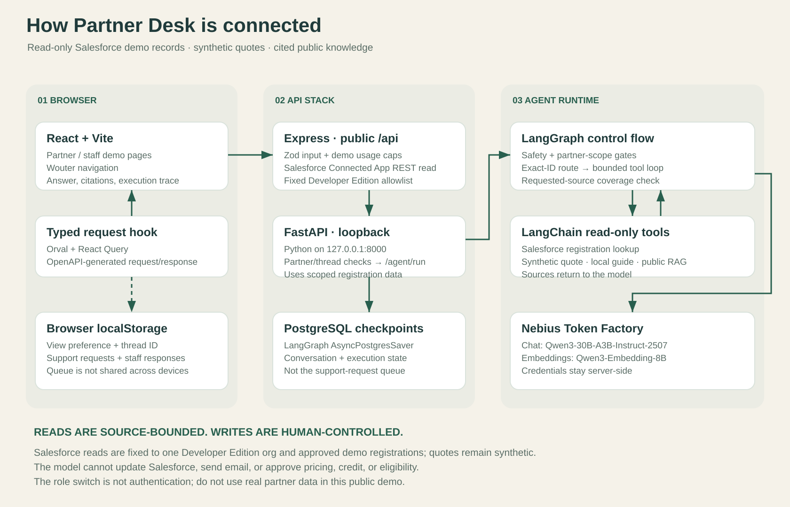
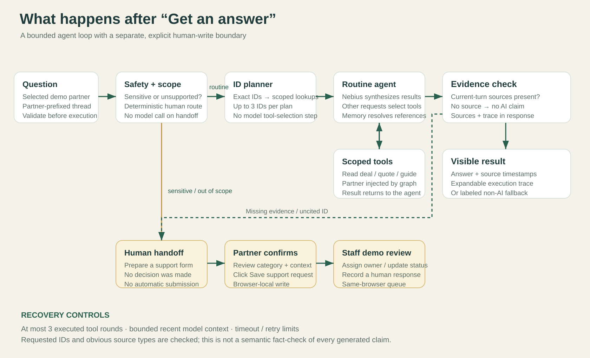
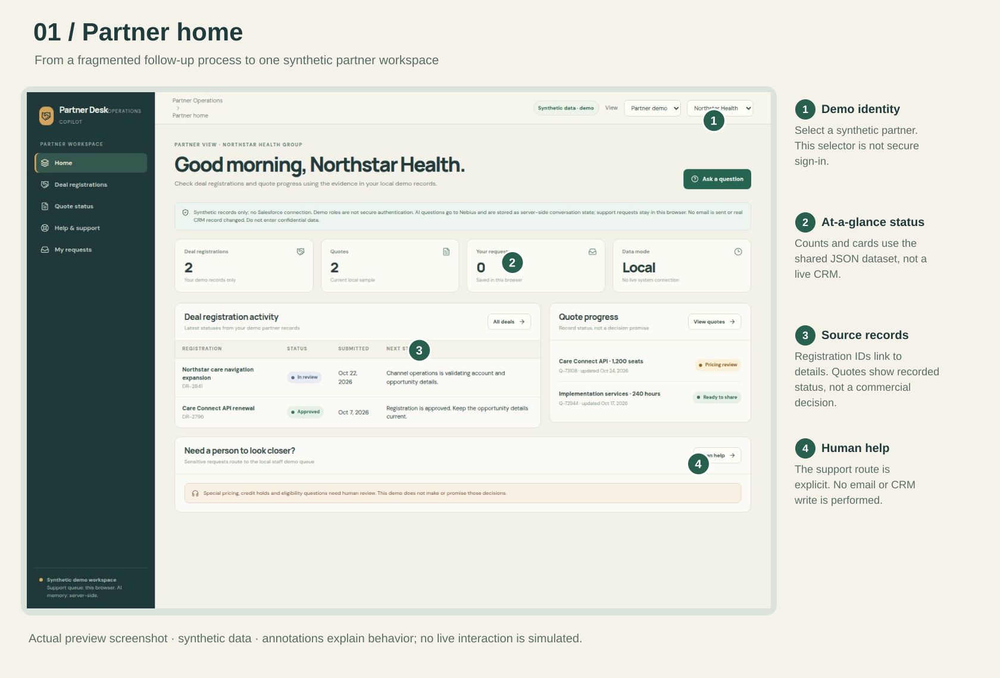
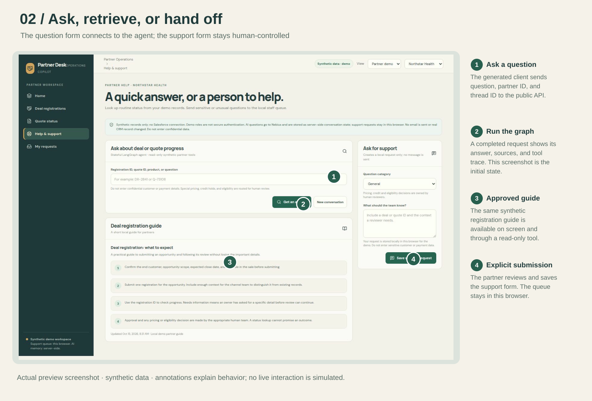
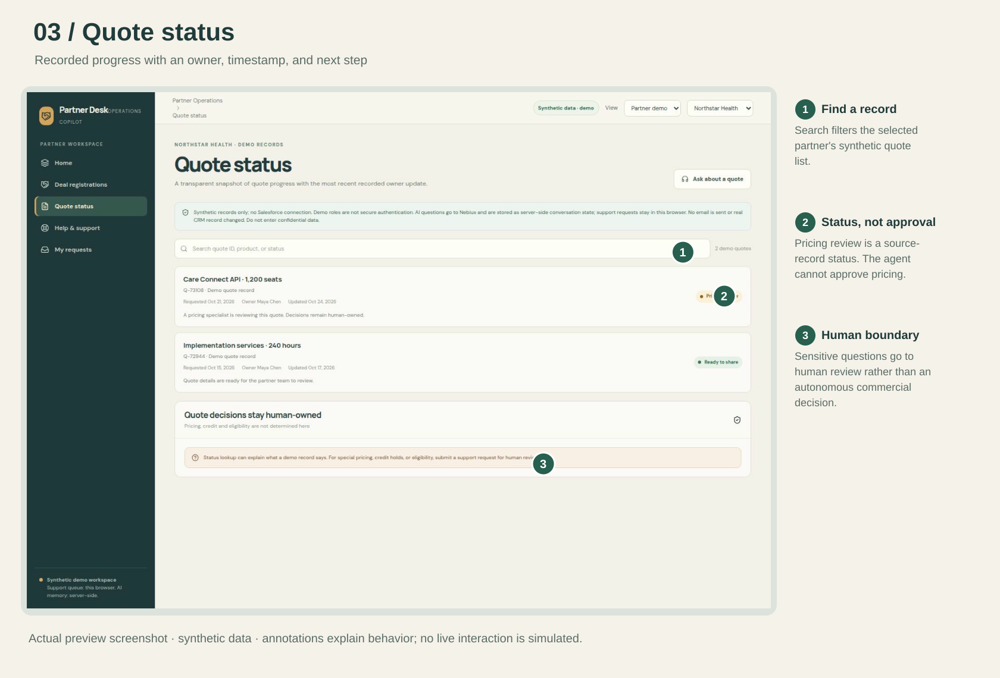

# Partner Operations Copilot — architecture and screen walkthrough

Documentation snapshot: 25 October 2026. Product UI name: **Partner Desk**. This describes the implemented synthetic-data demo, not a production deployment certification.

## 1. What the product does

Partners often wait for a representative to answer routine deal-registration and quote-status questions. Partner Operations Copilot puts those records, a registration guide, and a human-support path in one web workspace.

The agent routes exact deal/quote IDs to scoped read-only lookups, checks whether requested IDs and obvious source types were retrieved, and remembers the conversation. It does not approve commercial decisions, change Salesforce, or send an email. Staff can assign and respond to requests in the same browser's demo queue.

## 2. System architecture

```mermaid
flowchart LR
    UI["React + Vite pages / Wouter routes"] --> Hook["Orval-generated React Query mutation"]
    Hook --> Express["Express API / Zod / demo usage caps"]
    Express --> Python["Internal FastAPI service"]
    Python --> Gate["LangGraph safety and source-scope gates"]
    Gate -->|routine question| Planner["Exact-ID planner"]
    Planner -->|known deal/quote IDs| Tools["Partner-scoped deal / quote / guide tools"]
    Planner -->|other questions| Agent["Nebius tool-calling model via LangChain"]
    Agent <-->|bounded tool loop| Tools["Deal / quote / guide tools"]
    Tools --> Data["Canonical synthetic JSON"]
    Agent --> Evidence["Requested-record and source coverage check"]
    Evidence -->|all requested evidence| Answer["Answer + citations + trace"]
    Gate -->|sensitive or unsupported source| Human["Prepare human support form"]
    Evidence -->|missing / uncited evidence| Human
    Human --> Confirm["Partner explicitly submits"]
    Confirm --> Local["Browser-local support queue"]
    Python <--> DB[("PostgreSQL graph checkpoints")]
```





### The important separation

- The browser owns the interface, selected demo identity, thread identifier, and browser-local support queue.
- Express is the public API boundary. It validates requests, applies demo usage caps, and proxies agent requests.
- FastAPI is an internal Python service. It validates the partner/thread pair and invokes LangGraph.
- LangGraph coordinates control flow and stores conversation checkpoints in PostgreSQL.
- LangChain provides the model adapter and tools. Nebius supplies the model inference.
- Read-only tools use the same synthetic JSON file that the UI uses. There is no live CRM connector.

## 3. Technology choices and why they are present

| Component | Technology | Its job |
|---|---|---|
| Interface | React, TypeScript, Vite, CSS, Lucide icons | Render partner and staff workflows |
| Page navigation | Wouter | Connect home, deals, quotes, help, requests, and portfolio routes |
| API contract | OpenAPI, Orval, Zod | Generate matching client hooks and server validators |
| Request state | TanStack React Query | Manage the question mutation's pending, success, and error states |
| Public backend | Express / Node.js | Validate input, cap demo traffic, proxy the Python agent |
| Agent backend | FastAPI / Python | Run the Python graph behind the public API |
| Orchestration | LangGraph | Safety routing, tool loop, evidence boundary, checkpointed state |
| Model and tools | LangChain ChatOpenAI and ToolNode | Adapt Nebius's compatible API and execute scoped tools |
| Model inference | Nebius Token Factory, Qwen3-30B-A3B-Instruct-2507 | Select tools for other questions and summarize retrieved evidence |
| Conversation state | PostgreSQL, AsyncPostgresSaver | Keep graph history across turns and API restarts |
| Demo data | Shared JSON | Keep frontend records and tool lookups consistent |
| Human support state | Browser localStorage | Preserve local requests, staff responses, and view preferences |

The project contains a shared Drizzle/database library, but LangGraph checkpoint persistence is implemented by the Python PostgreSQL saver. Support requests are not currently stored in a Drizzle-backed server table.

## 4. How a page connects to the backend

The frontend's `HelpPage` lives in `artifacts/partner-status-agent/src/App.tsx`. Clicking **Get an answer** runs `useAnswerPartnerQuestion`, generated from `lib/api-spec/openapi.yaml`.

The browser sends three fields:

```json
{
  "question": "What is the status of DR-2841?",
  "partnerId": "p-northstar",
  "threadId": "p-northstar-example-conversation"
}
```

1. The generated client posts to `POST /api/partner-agent/answer`.
2. `artifacts/api-server/src/routes/partner-agent.ts` checks the Zod input schema and in-memory usage limits.
3. Express forwards the request to the loopback service at `POST http://127.0.0.1:8000/agent/run`. The browser never calls this internal address.
4. FastAPI checks the known synthetic partner and requires a matching partner-prefixed thread ID.
5. LangGraph resumes that thread's checkpoint, runs the safety and source-scope gates, then routes exact IDs directly to read-only tools or continues through the routine agent path.
6. The response returns through Express with `answer`, `mode`, `provider`, `intent`, `sources`, `trace`, `toolCalls`, and handoff fields.
7. React displays the result, source timestamps, expandable execution trace, and the human-support action when needed.

The source API schema is the contract. Generated client files are regenerated after schema changes, rather than edited by hand.

## 5. Agent decisions and human boundaries



For an exact deal or quote ID, a deterministic planner routes the lookup before the model runs. The model then summarizes the returned record. For other routine questions, the first model step requires a read-only tool call. LangGraph injects the selected partner into every tool; the model cannot supply or override that scope. A plan can include up to three distinct IDs.

The three tools are:

- `lookup_deal_status`: find a registration by exact ID or a matching description within the selected partner's records.
- `lookup_quote_status`: find a quote by ID or product within the selected partner's records.
- `search_registration_guide`: retrieve approved synthetic deal-registration guidance.

Tool results go back into the agent loop. Before showing an AI answer, the finalizer checks that requested record IDs have matching citations, that the expected deal/quote/guide tools ran for obvious request cues, and that the draft did not introduce uncited record IDs. If any check fails, it withholds the partial model answer, keeps any available evidence visible, and offers human support. This is a coverage check, not a comprehensive semantic fact-check of every generated sentence.

Questions matching sensitive pricing, credit, approval, or eligibility rules take the human path without a model call. Requests for disconnected release/portfolio data, renewals, product positioning, or enablement content also go to human support rather than being answered from unrelated records. The partner must review and explicitly save the support form. Staff manually assign ownership, update status, and record a response.

This is an application-level human approval boundary, not a LangGraph interrupt/resume approval queue.

## 6. Memory: what is stored where

| State | Location | Important limitation |
|---|---|---|
| Conversation messages and graph checkpoints | PostgreSQL | Server-side; no automatic retention/deletion policy yet |
| Conversation thread ID | Browser localStorage, per selected demo partner | New conversation starts a new ID; old database history is not deleted |
| Recent model context | Bounded recent-message window | Follow-ups can resolve references, but current status must be looked up again |
| Partner/staff demo preference | Browser localStorage | This is a preference, not authenticated identity |
| Support requests and staff responses | Browser localStorage | Not shared across browsers or devices |
| Deals, quotes, guide | Canonical JSON | Read-only synthetic examples; relative dates are not live CRM refreshes |

No external long-term memory, vector database, web research, or observability service is connected in this build. The current flow only uses synthetic records and the approved local registration guide.

## 7. Walk through the real screens

### Partner home



The homepage shows the selected synthetic partner's registrations, quotes, and local support count. Choosing a record opens the appropriate page; Ask a question leads to Help.

The demo identity selector changes the example being viewed. It must not be described as secure tenant authorization.

### Help and support



The left side runs the question workflow and shows the guide. Results show the answer, sources, and trace after a request completes; the supplied screenshot is the untouched initial state, not a fabricated live answer.

The support form is a separate, explicit human write. Preparing it does not submit it. Saving it creates only a browser-local request.

### Quote status



Each record has an ID, product, status, owner, timestamp, and next step. Pricing review is a recorded status, not permission to approve pricing.

Staff mode additionally exposes the request queue and partner portfolio. That existing demo workflow is described here; the screenshots do not claim to show a signed-in staff session.

## 8. Reliability and credential handling

- Only synthetic records appear in these assets. No secret values, authorization headers, cookies, or billing/account screens are included.
- The Nebius credential remains server-side. The public browser only calls the app API, not the provider directly.
- The model is configured with 600 output tokens, a 20-second provider timeout, and one retry. These are per model request, not an end-to-end latency guarantee.
- The graph permits at most three executed tool rounds and uses a recursion limit of 12.
- Express aborts the internal request after 50 seconds; aborting a proxy request is not a guarantee that upstream model billing stops immediately.
- Demo usage caps are 10 requests per IP per hour and 100 per day, held in memory. They reset on restart and are not a hard billing budget.
- Tool errors and missing sources produce a labeled exact-match fallback only when it covers every requested record; otherwise the partial answer is withheld and human support is offered.
- Exact IDs are planned directly to their scoped lookup tools; incomplete multi-record answers and uncited IDs are blocked before display.
- Release, renewal, product-positioning, enablement, and aggregate portfolio questions are clearly routed to human support because their data sources are not connected.
- Explicit unknown IDs cannot silently turn into a fuzzy match. Unapproved generated URLs are removed from displayed answers.
- Scope checks are useful within the demo but are not a substitute for authentication and server-owned tenant identity.
- This documentation pass used static screenshots and source inspection; no additional Nebius calls were needed.

## 9. What is implemented, and what is not

**Implemented in this snapshot:** partner/staff demo views; three read-only agent tools; PostgreSQL graph memory; citations and execution traces; bounded recovery; browser-local human request and response workflow.

**Separate work in progress:** secure partner/staff sign-in. The existence of configured credentials does not mean an authentication feature is implemented, merged, or verified. Shared cross-device support requests are also outside this snapshot.

**Not connected:** Salesforce, live portals, email sending, real quote generation, CRM writes, or automated commercial approvals. Product positioning, renewals, enablement content, release information, and aggregate portfolio queries route through human support; dedicated data sources and tools for those areas are not implemented.

**Verification from this build:** thirteen deterministic Python tests cover direct ID planning, partner scoping, sensitive and unsupported-source routing, multi-record coverage, recovery, and the tool-round limit. This is not a production certification or a business success measurement.

**Business target, not measured:** eight out of ten routine tasks completed in under two minutes each. Do not present that target as a measured accuracy or time-saving result.

## 10. File map for GitHub reviewers

| Path | Review here for |
|---|---|
| `artifacts/partner-status-agent/src/App.tsx` | Pages, demo roles, Help mutation, and local support workflow |
| `artifacts/partner-status-agent/src/demo-records.json` | Canonical synthetic data |
| `lib/api-spec/openapi.yaml` | Request/response contract |
| `lib/api-client-react/` | Generated frontend client and fetch adapter |
| `artifacts/api-server/src/routes/partner-agent.ts` | Public proxy, validation, and demo caps |
| `src/partner_agent_graph/api.py` | Internal API and persistent graph lifetime |
| `src/partner_agent_graph/graph.py` | Safety rules, agent loop, evidence checks, recovery |
| `src/partner_agent_graph/tools.py` | Read-only, injected-partner tools |
| `src/partner_agent_graph/setup_checkpoint.py` | One-time development checkpoint schema setup |
| `scripts/run-api-stack.sh` | Start Express and the loopback Python service together |
| `tests/test_partner_agent_graph.py` | Deterministic graph/scope/recovery tests |

The main repository README contains setup commands. Use a secret manager for credentials; never put values in README examples or a repository archive. Production startup does not run schema-creation DDL.

## 11. Suggested live demonstration

1. Select Northstar and open Help.
2. Ask: “What is the status of DR-2841?” Show the citation and trace.
3. Ask: “Who owns that deal?” Explain thread memory plus a fresh lookup.
4. Ask: “What is the status of Q-73108?”
5. Ask: “How do I submit a deal registration?”
6. Ask: “Can you approve a special pricing discount?” Show the human route.
7. Review and explicitly save the support request; switch to Staff demo and record a response.
8. Explain the synthetic-data, local-queue, authentication, and live-CRM limitations.

The separate animated video is an explanatory reconstruction using screenshots and implementation facts. It is not evidence that a continuous live walkthrough was recorded. For the Week 3 live-demo requirement, use the five-minute script in `artifacts/partner-status-agent/docs/demo-script.md`.

## 12. Reuse this bundle

Keep this README, both SVG diagrams, the annotated SVGs, and the screenshots together in a GitHub `docs/` folder. The diagrams and annotations are portable vector files. A self-contained HTML report and PDF are provided separately for sharing.

The ZIP is a documentation bundle, not a replacement for the complete application repository. Revisit this snapshot after the separate sign-in or shared-queue changes are merged.
